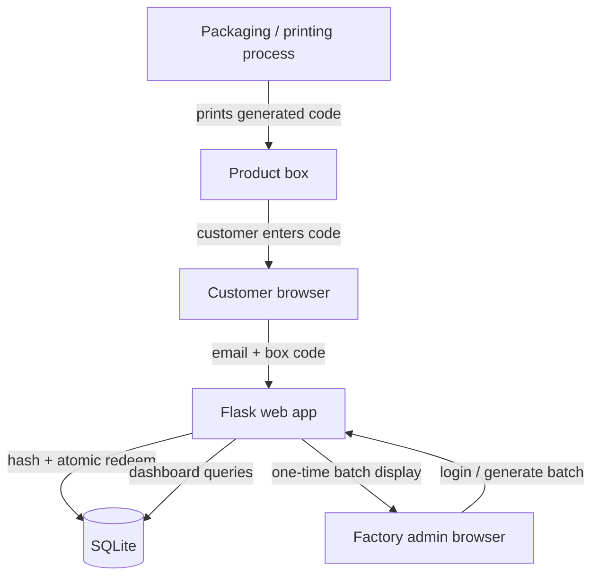

# Architecture

## Stack choice
- **Flask/Python:** small, readable server-rendered application with minimal setup.
- **SQLite:** persistent local relational store; unique constraints and write transactions support one-time redemption in the MVP.
- **HTML/CSS:** lightweight customer and admin interfaces without a separate frontend build pipeline.

## Main flow
1. Factory staff authenticate and generate a batch of random codes.
2. The factory prints one code inside each product box. Raw codes are displayed once at batch creation.
3. Customer submits email + box code.
4. Server normalizes and hashes the code, then starts a write transaction.
5. Server checks that the hash exists and status is `unused`; conditionally changes it to `redeemed`, creates a redemption record, and increments the customer's points.
6. Admin dashboard reads aggregate and recent activity from the database.

## Data model
- `codes(id, code_hash UNIQUE, points, status, redeemed_by, redeemed_at)`: one row per box; raw code is not persisted.
- `customers(email PRIMARY KEY, points, boxes)`: one customer balance per normalized email.
- `redemptions(id, code_id UNIQUE FK, customer, points, redeemed_at)`: immutable redemption ledger; unique `code_id` prevents a second ledger entry for a box.

## Component diagram

## Security and integrity
- Codes use cryptographically secure random selection.
- Only normalized SHA-256 digests are stored.
- Database uniqueness prevents duplicate code hashes and duplicate redemption rows.
- `BEGIN IMMEDIATE` serializes competing SQLite writers; conditional status update ensures only one request can claim a code.
- Customer emails are normalized to lowercase; output is escaped by Jinja templates.
- Admin session authentication is a simple MVP control. Production must add CSRF, throttling, secure cookie configuration, individual admin identities, password hashing, and audit logging.

## Scaling path
For multi-worker or multi-region deployments migrate to PostgreSQL, keep redemption in a single transaction with `UPDATE ... WHERE status='unused' RETURNING ...`, use a managed secrets store, add queue-backed batch export, and monitor failed/repeated redemption attempts.
